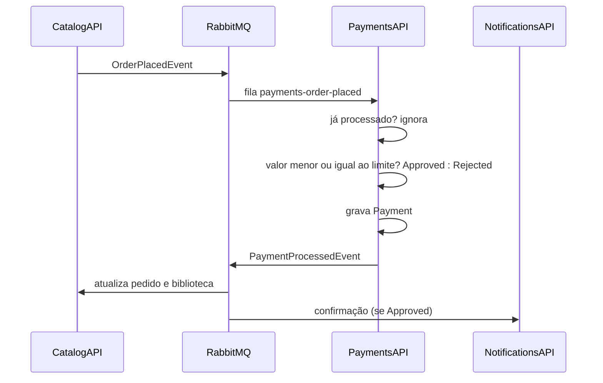

# FCG.PaymentsAPI

Microsserviço de **pagamentos** da FIAP Cloud Games (FCG), Fase 2. Consome os pedidos criados no Catalog (`OrderPlacedEvent`), **simula** o processamento do pagamento, persiste o resultado e publica o `PaymentProcessedEvent`, que o Catalog e o Notifications consomem.

## Papel no ecossistema



## Estrutura

```
01- API/FCG.Payments.Api                         Controller de consulta, validação JWT, Swagger, /health
02- Core/FCG.Payments.Application                PaymentService, DTO, IEventPublisher, ICurrentUser
02- Core/FCG.Payments.Domain                     Entidade Payment (regra de aprovação), PaymentStatus, PaymentSettings, repositório
03- Infrastructure/FCG.Payments.Infrastructure   EF Core + Npgsql, migrations, repositório, MassTransit (OrderPlacedConsumer), DI
05- Tests/FCG.Payments.UnitTests                 Regra do limite, idempotência, acesso
05- Tests/FCG.Payments.IntegrationTests          API + PostgreSQL (Testcontainers) + MassTransit Test Harness
Contracts/Events.cs                              Contratos de integração (idênticos em todos os repositórios)
k8s/                                             Deployment, Service, ConfigMap, Secret, kustomization
Dockerfile                                       Build multi-stage, usuário não-root
```

## Entidade e regras de negócio

| Entidade | Descrição |
|----------|-----------|
| `Payment` | `OrderId` (único), `UserId`, `UserEmail`, `GameId`, `GameName`, `Amount`, `Status` (`Approved` ou `Rejected`) e `ProcessedAt` |

- **Regra simulada e determinística** (`Payment.Process`): o pagamento é `Approved` se `Amount <= Payments:MaxApprovedAmount` (padrão **100,00**, configurado no ConfigMap) e `Rejected` caso contrário. Isso permite demonstrar os dois caminhos só escolhendo o preço do jogo.
- **Idempotência por `OrderId`**: se o mesmo pedido chegar de novo (reentrega do broker), ele não é reprocessado nem republicado. O índice único em `OrderId` protege também contra concorrência.
- O pagamento é salvo **antes** de o `PaymentProcessedEvent` ser publicado.
- O evento leva o e-mail e o jogo, para que o Notifications funcione sem consultar outros serviços.

## Endpoints

| Método | Rota | Acesso | Descrição |
|--------|------|--------|-----------|
| GET | `/api/v1/payments/orders/{orderId}` | Dono do pedido ou Admin | Resultado do pagamento do pedido |
| GET | `/health` e `/health/live` | Anônimo | Readiness (inclui o banco) e liveness |

```json
{ "value": { "id": 1, "orderId": 1, "userId": 2, "userEmail": "player@fcg.com", "gameId": 1, "gameName": "Hollow Knight", "amount": 59.90, "status": "Approved", "processedAt": "..." }, "success": true }
```

O processamento em si não tem endpoint: acontece só pelo evento.

## Eventos

| Direção | Evento | Payload | Quando |
|---------|--------|---------|--------|
| Consome | `OrderPlacedEvent` | `OrderId`, `UserId`, `UserEmail`, `GameId`, `GameName`, `Price` | Fila `payments-order-placed` |
| Publica | `PaymentProcessedEvent` | Os campos acima e mais o `Status` (`Approved` = 1, `Rejected` = 2) | Após persistir o pagamento |

## Configuração

| Variável | Origem no k8s | Padrão local |
|----------|---------------|--------------|
| `ConnectionStrings__DbConnection` | Secret | `Host=localhost;Port=5434;Database=fcg_payments;Username=postgres;Password=postgres` |
| `Payments__MaxApprovedAmount` | ConfigMap | `100.00` |
| `RabbitMq__Host` / `RabbitMq__VirtualHost` | ConfigMap | `localhost` / `/` |
| `RabbitMq__Username` / `RabbitMq__Password` | Secret | `fcg` / `fcg` |
| `RabbitMq__OrderPlacedQueue` | ConfigMap | `payments-order-placed` |
| `TokenSettings__Issuer` / `TokenSettings__Audience` | ConfigMap | `FCG.Users` / `FCG.Client` |
| `TokenSettings__Key` | Secret | a mesma chave do UsersAPI |

## Como executar

**Local**

```powershell
cd ../FCG.Orchestration; docker compose up -d postgres rabbitmq
cd ../FCG.PaymentsAPI; dotnet run --project "01- API/FCG.Payments.Api"   # http://localhost:5103/swagger
```

**Docker**: `docker build -t fcg-payments-api:latest .`

**Kubernetes**: `kubectl apply -k k8s` (ou `kubectl apply -f k8s/`), seguido de `kubectl get pods`. Pressupõe os Services `postgres` e `rabbitmq`. No Kind, rode antes `kind load docker-image fcg-payments-api:latest`. Para mudar a regra, edite `Payments__MaxApprovedAmount` no ConfigMap e reinicie o deployment.

## Testes

```powershell
dotnet test --project "05- Tests/FCG.Payments.UnitTests/FCG.Payments.UnitTests.csproj"                # 20 execuções
dotnet test --project "05- Tests/FCG.Payments.IntegrationTests/FCG.Payments.IntegrationTests.csproj"  # 9 execuções, requer Docker
```

- **Unitários**: aprovação abaixo do limite e exatamente no limite, rejeição acima do limite, rastreabilidade dos dados, publicação depois de salvar, pedido duplicado ignorado e regras de acesso à consulta.
- **Integração**: o `OrderPlacedEvent` injetado pelo harness gera o registro no PostgreSQL e o `PaymentProcessedEvent` com o status correto. Um evento duplicado resulta em um único registro e uma única publicação. A consulta HTTP responde 200, 401, 403 e 404 conforme o caso.

O detalhamento está em [`05- Tests/TESTS.md`](05-%20Tests/TESTS.md).
